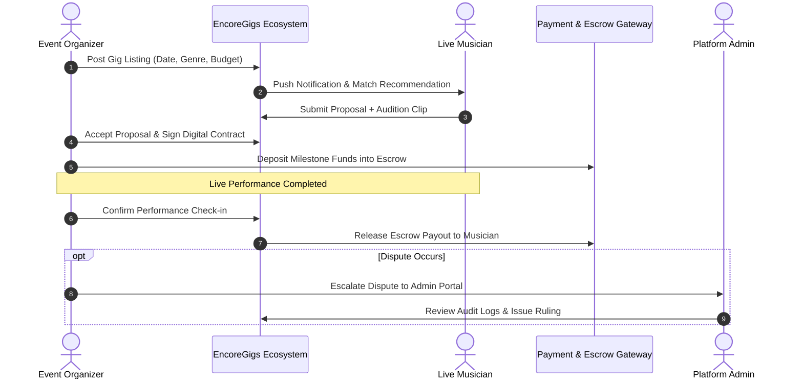

<div align="center">

<p align="center">
  
  
</p>
<p align="center">
  <em>Left: Production Client Mark (OnlyGigz Trademark) &bull; Right: Architectural Platform Identity (EncoreGigs)</em>
</p>

# EncoreGigs Platform

### Full-Stack Live Music Marketplace & Talent Booking Ecosystem

[](https://flutter.dev)
[](https://nextjs.org)
[](https://react.dev)
[](https://typescriptlang.org)
[](https://python.org)
[](https://firebase.google.com)
[](https://tailwindcss.com)
[](LICENSE)
[](https://play.google.com/store/apps/details?id=com.onlygigz.musician)

<p align="center">
  <b>EncoreGigs</b> is an enterprise-grade, two-sided gig economy marketplace connecting professional live musicians with event organizers, venue hosts, and wedding planners. Built as a monorepo containing dual native Flutter mobile apps, an administrative Next.js web portal, and Python backend services.
</p>

</div>

> ### 📱 Verified Live Production Releases
> - **Live Musician App on Google Play:** [OnlyGigz Musician on Play Store](https://play.google.com/store/apps/details?id=com.onlygigz.musician)
> - **Live Organizer App on Google Play:** [OnlyGigz Organizer on Play Store](https://play.google.com/store/apps/details?id=com.onlygigz.organizer)
> - **Engineering Provenance:** Architected, engineered, and published to production by **Muhammad Ali**. This monorepo serves as the open-source sanitized demonstration (**EncoreGigs Platform**), showcasing the dual Flutter applications, Next.js admin dashboard, and Python microservices under white-label terms respecting commercial NDAs.

---

## 🌟 Ecosystem Architecture

EncoreGigs provides specialized interfaces for each stakeholder in the live music lifecycle, ensuring seamless contract negotiation, escrow payments, and live day-of-event execution.

```mermaid
graph TD
    subgraph EncoreGigs Monorepo Ecosystem
        direction TB
        M[Musician App / Flutter]
        O[Organizer App / Flutter]
        W[Admin Web Portal / Next.js]
        B[Backend & Microservices / Python]
    end

    subgraph Musician Experience
        M --> M1[Audio & Video Portfolio]
        M --> M2[Calendar & Availability Sync]
        M --> M3[Gig Proposals & Counter-offers]
        M --> M4[Digital Contract Signing]
        M --> M5[Payouts & P&L Earnings]
    end

    subgraph Organizer Experience
        O --> O1[Event Creation & Budgeting]
        O --> O2[Talent Search & Genre Filters]
        O --> O3[Escrow Milestone Funding]
        O --> O4[Day-of-Event Check-in]
        O --> O5[Reviews & Star Ratings]
    end

    subgraph Platform Governance
        W --> W1[Dispute Resolution Center]
        W --> W2[User Identity Verification]
        W --> W3[Financial Auditing & Escrow]
        W --> W4[Automated Venue Scraper]
    end
```



---

## 🏗️ System Flow & Interactions



---

## 📁 Repository Structure

```
EncoreGigs-Platform/
├── apps/
│   ├── musician/                  # Flutter iOS & Android app for Performers
│   │   ├── lib/                   # Audio showcase, gig calendar, contract signing
│   │   └── assets/                # Performer UI vectors, icons, and theme assets
│   └── organizer/                 # Flutter iOS & Android app for Event Planners
│       ├── lib/                   # Venue manager, talent discovery, escrow flows
│       └── assets/                # Event creation & organizer assets
├── web/
│   └── admin_portal/              # Next.js 14 App Router Administrator Dashboard
│       ├── src/app/               # Modern React dashboard routes (Contracts, Disputes, Users)
│       ├── src/components/        # Reusable Tailwind UI components & modals
│       └── src/lib/               # Firebase Admin & API connectors
├── backend/                       # Python REST API & Microservices
│   ├── app.py                     # API router & middleware
│   └── services/                  # Calendar sync, payout logic, contracts
├── scraper/                       # Python venue and event lead crawler
├── functions/                     # Firebase Cloud Functions (Triggers, Push Notifications)
├── assets/branding/               # High-res vector and brand assets
└── README.md
```

---

## ✨ Monorepo Components

### 🎸 1. Musician Native App (`apps/musician`)
- **Digital EPK (Electronic Press Kit):** Integrated audio samples, video reels, technical riders, and genre badges.
- **Dynamic Gig Calendar:** Real-time availability schedule preventing double-bookings across external calendars.
- **Contract & Offer Engine:** Formal contractual terms, rider agreements, cancellation terms, and digital signatures.
- **Financial Dashboard:** Real-time visibility into completed gigs, pending escrow releases, and direct deposit withdrawals.

### 🎪 2. Organizer Native App (`apps/organizer`)
- **Event Spec Builder:** Post detailed gig listings with acoustic requirements, venue dimensions, audience size, and budget.
- **Curated Talent Search:** Filter by radius, hourly rate, genre, ratings, instrumentation, and verified status.
- **Escrow-Backed Booking:** Peace of mind with secure milestone deposits held until event completion.
- **Direct Real-Time Chat:** Coordinate sound checks, setlists, and arrival logistics via instant messaging.

### 💻 3. Enterprise Admin Portal (`web/admin_portal`)
- **Built with Next.js 14 App Router, TypeScript, and TailwindCSS.**
- **Dispute Resolution Board:** Comprehensive review tools with contract history and messaging logs.
- **Identity & Background Verification:** KYC vetting for verified badge placement.
- **Marketplace Health Analytics:** Real-time revenue, gross merchandise volume (GMV), active bookings, and churn metrics.

---

## 🚀 Getting Started

### 1. Mobile Applications (Musician / Organizer)
```bash
# To run Musician App
cd apps/musician
flutter pub get
flutter run

# To run Organizer App
cd apps/organizer
flutter pub get
flutter run
```

### 2. Admin Web Portal
```bash
cd web/admin_portal
npm install
npm run dev
# Dashboard opens on http://localhost:3000
```

### 3. Backend Microservices
```bash
cd backend
python3 -m venv venv
source venv/bin/activate
pip install -r requirements.txt
python app.py
```

---

## 🔒 Confidentiality & White-Label Notice
This codebase is an open-source demonstration and portfolio showcase. All proprietary client data, private Apple development certificates (`.cer`, `.p12`, `.mobileprovision`), sensitive third-party API keys, and private client contract documents have been removed and sanitized.

---

## 👨‍💻 Author
**Muhammad Ali**
- GitHub: [@itismemuhammadali](https://github.com/itismemuhammadali)
- Portfolio & Engineering Showcase
